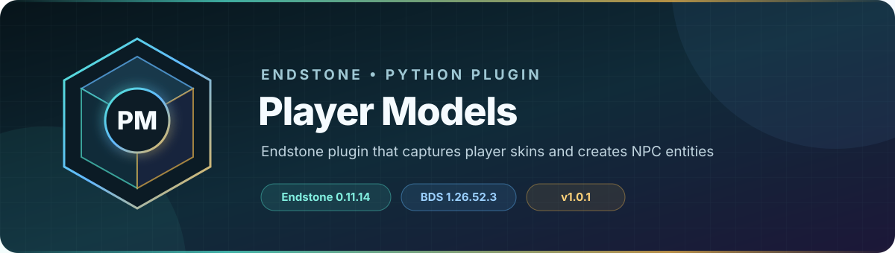

<!-- endstone-professional-header:start -->
<p align="center">
  
</p>

<p align="center">
  <a href="https://github.com/TheNINJALLO/endstone-player-models/actions/workflows/wheel-release.yml"></a>
  <a href="https://github.com/TheNINJALLO/endstone-player-models/releases/latest"></a>
</p>

<p align="center">
  
  
  
  =3.10" src="https://img.shields.io/badge/Python-%3E=3.10-3776AB?style=flat-square&amp;logo=python&amp;logoColor=white">
</p>

<p align="center">
  <strong>Endstone plugin that captures player skins and creates NPC entities.</strong>
</p>

<p align="center">
  <a href="#overview">Overview</a> &bull;
  <a href="#compatibility">Compatibility</a> &bull;
  <a href="#install">Install</a> &bull;
  <a href="https://github.com/TheNINJALLO/endstone-player-models/releases">Releases</a>
</p>

## Overview

Endstone plugin that captures player skins and creates NPC entities. This release is aligned with Endstone 0.11.8 and Minecraft Bedrock Dedicated Server 1.26.40, and is distributed as a Python wheel for direct installation in an Endstone server.

## Capabilities

-

## Compatibility

| Component | Supported version |
|---|---|
| Endstone | `0.11.8` |
| Endstone API | `0.11` |
| Bedrock Dedicated Server | `1.26.40` |
| Python | `>=3.10` |
| Plugin release | `v1.0.1` |

## Install

Download the wheel from the matching GitHub release:

```bash
gh release download v1.0.1 --repo TheNINJALLO/endstone-player-models --pattern "*.whl"
```

Copy the downloaded wheel into the server's `plugins/` directory, remove any older wheel for the same plugin, and restart Endstone.

> [!IMPORTANT]
> Use Endstone `0.11.8` with BDS `1.26.40`. Back up worlds and plugin data before upgrading a production server.

## Configuration and secrets

Runtime databases, logs, local `.env` files, server directories, and root `config.toml` files are excluded from source releases. When an example configuration is provided, copy it locally and keep live tokens, passwords, webhook URLs, and server identifiers out of Git.

## Release automation

Every `v*` tag runs [the wheel release workflow](.github/workflows/wheel-release.yml), builds the package in a clean GitHub runner, stores the wheel as a workflow artifact, and attaches it to the matching GitHub release.
<!-- endstone-professional-header:end -->

---

## Project guide

An Endstone plugin that captures player skins and creates unique NPC entities for each player.

## Features

- **Automatic Skin Capture**: Captures player skins when they join or change their skin
- **Unique Entity IDs**: Creates entities with player-based identifiers (e.g., `ninjos:playername`)
- **Skin Change Versioning**: Tracks skin changes with versioned entities (`ninjos:playername2`, etc.)
- **3D Skin Detection**: Skips 128x128 custom skins that don't fit the standard player model
- **Auto-Deployment**: Automatically deploys addon files to the server on plugin load

## Configuration

Edit `config.json`:

```json
{
    "server_path": "/home/container",
    "world_folder_name": "MyWorld",
    "skip_3d_skins": true,
    "enable_on_join": true,
    "enable_on_skin_change": true,
    "addon_namespace": "ninjos"
}
```

## Usage

After a player joins, spawn their NPC using:

```
/summon ninjos:playername
```

## Installation

1. Build the plugin: `pip install build && python -m build`
2. Install the wheel in your Endstone plugins folder
3. Configure `config.json` with your world folder name
4. Start the server

## License

MIT
